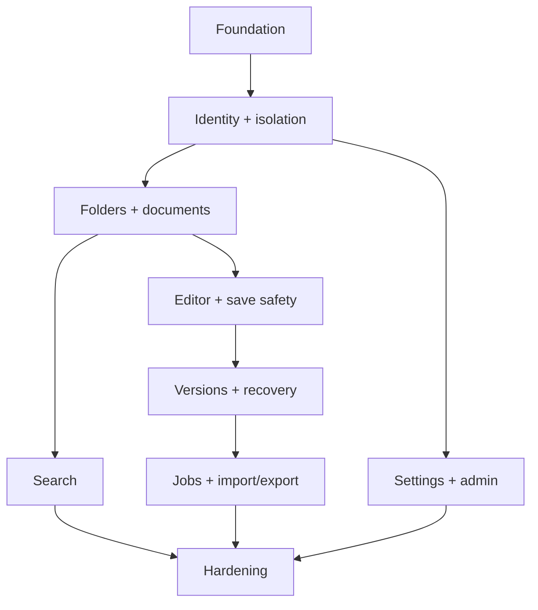

# 08 — Implementation Task Graph

Implement as vertical slices. Each phase exits only with tests/evidence for its acceptance IDs. Parallel work is safe only across modules whose contracts are already fixed.

## Phase 0 — Foundation and contract lock

- Create monorepo structure, pinned toolchain/lockfile, lint/type/test commands.
- Implement typed configuration, request/error envelope, migration harness, test PostgreSQL.
- Establish design tokens/component primitives and copy visual reference into documentation.
- Define shared DTO schemas, naming policy and Markdown Capability Registry interfaces.

Exit: boot/readiness/config failure tests; empty migration; basic accessible shell; OpenAPI generation check.

## Phase 1 — Identity and isolation

- User/workspace/session schema; bootstrap admin; login/logout/me/password/sessions.
- Auth guards, workspace principal, repository scoping, rate limit and audit foundation.
- Global shell and route guards.

Exit: AUTH/ISO acceptance rows and cross-workspace adversarial suite.

## Phase 2 — Folder/document vertical slice

- Folder/document schemas, normalized uniqueness, hierarchy services, stable routes.
- Tree/list/create/open/rename/move/bulk/trash basics.
- Transaction and optimistic rollback behavior.

Exit: FOL/DOC core rows; 10k-node tree fixture baseline.

## Phase 3 — Markdown and editor safety

- Source editor first, renderer/sanitizer, shared fixtures.
- WYSIWYG adapters, raw-preserved nodes, Split, toolbar/outline.
- Revision-guarded save, status state machine, local draft/reconnect/conflict.
- Large-document degradation.

Exit: EDIT/DRAFT/security rows. Do not proceed to import until protected Replace/version behavior is stable.

## Phase 4 — Versions, trash and recovery

- Version policies/list/preview/diff/restore.
- Restore conflicts; permanent-delete state/job.
- Recovery surfaces and scoped error/loading states.

Exit: VER/TRASH/ERR rows including worker-restart delete drill.

## Phase 5 — Search and commands

- PostgreSQL provider, indexing/update path, scope ancestry.
- Quick Open/Search/Command Palette.
- English/CJK benchmark and provider decision ADR.

Exit: SRCH rows and agreed benchmark.

## Phase 6 — Durable job platform, import and export

- PostgreSQL leases, checkpoints, idempotency, job/item APIs/UI.
- Secure temp workspace and orphan cleanup.
- Preview plan, conflict resolution, partial result and retry-failed.
- Consistent export manifest, ZIP/download authorization.

Exit: JOB/IMP/EXP rows including malicious archives, restart and concurrent-edit export tests.

## Phase 7 — Settings and administration

- Typed user preferences and Settings UX.
- Admin overview/users/config/security/jobs/audit/health.
- Privacy-negative tests and last-admin protection.

Exit: PREF/ADM/AUD rows.

## Phase 8 — Hardening and release candidate

- Responsive/visual/accessibility passes; error/empty/loading/offline matrix.
- Performance profiles and query/index correction.
- Compose/reverse proxy/security headers/backup restore/migration drills.
- Operator and developer docs; acceptance evidence index.

Exit: every P0/P1 accepted, P2 disposition recorded, no P0 open question, clean install and upgrade rehearsal.

## Dependency summary

## Change discipline

Each pull request states requirement IDs, migrations, security/privacy effects, tests, screenshots for UI states, and rollback considerations. A change that alters a DTO updates server schema, generated client, API examples and integration tests atomically.

