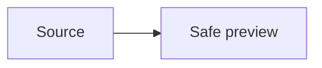

# Capability fixture

Paragraph with **strong**, _emphasis_, [safe link](https://example.com), and `inline code`.

> A blockquote with ~~strike~~.

- [x] completed task
- [ ] pending task

| Name | Value |
| --- | ---: |
| English | 1 |
| 中文 | 2 |

```ts
const safe = true;
```



Inline math $E=mc^2$ and block math:

$$
\int_0^1 x^2 dx
$$

Unicode: 中文、emoji 📝.
